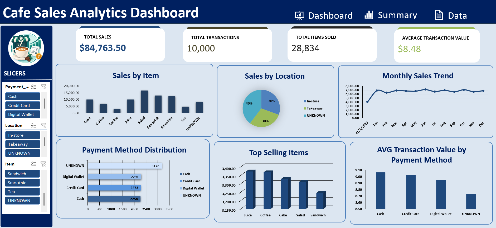

# 🍵Cafe Sales Analysis

## 📌Project Overview

This project analyzes cafe sales data using Microsoft Excel.
The project was completed in three main stages:

1. Data Cleaning
2. Pivot Analysis
3. Dashboard Development

The goal is to transform raw cafe sales data into a clean, structured, and interactive dashboard that providezs useful business insights.

---

## Objectives

- Clean and prepare the raw cafe sales data for analysis.
- Analyze Sales performance using PivotTables.
- Calculate key performance indicators (KPIs).
- Identify sales patterns by item, location, payment method and time.
- Create an interactive dashboard using PivotCharts, Slicers and Timeline.

## 🗒️Dataset

The dataset contains transaction-level information about cafe sales:

- Transaction_ID
- Item
- Quantity
- Price_per_unit
- Total_Spent
- Payment_Method
- Location
- Transaction_Date

## 🧹Data Cleaning

- Cheked for missing values
- Handle "ERROR" and unknown values
- Standardized categorical values
- Converted dates to the correct date format
- Ensured numerical columns were stored as numbers 
- Formatted "Transaction_ID" as text
- Cheked for duplicate
- Converted the dataset into a Excel Table

## 🔎Analysis Questions

- Which items generate the highest total sales ?
- Which location generates the highest total sales ?
- How do sales change over time ?
- Which payment methods are most commonly used bu customers ?
- Which items are sold in the highest quantities ?
- Which payment method has the highest average transaction value ?

---

## 📊Dashboard Developement 

The final stage was creating an interactive sales dashboard.

## Dashboard Components

## 🎯Key Performance Indicators (KPIs)

- Total Sales
- Total Transactions
- Total Items Sold
- Average Transaction Values

## Charts

- Monthly Sales Trend
- Sales by Item
- Top Selling Items
- Payment Method Distribution
- Sales by Location
- AVG Transaction Value by Payment Method

## Interactive Filters

- Location Slicer
- Payment Method Slicer
- Item Slicer

The Dashboard allows users to filter the data and dynamically explore cafe sales performance.

## Dashboard Preview

## 🛠️Tools Used

- Microsoft Excel
- Pivot Tables
- Pivot Charts 
- Slicers
- Timeline
- Excel Formulas

---

## 💡Results

- Analyzed total sales across different items and locations.
- Identified top-selling items based on sales performance.
- Examined monthly salrs trends to understand how sales change over time.
- Explored the distribution of transactions across payment methods.
- Compared the average transaction value across different payment methods.
- Developed an interactive excel dashboard using PivotTables, PivotCharts, results easier to explore.

---

## ✔️Conclusion 

This project used Microsoft Excel to analyze cafe sales data and build an interactive dashboard. The analysis covered sales performance by item and location, monthly sales trend, payment methods, and average transaction values.

Through data cleaning, PivotTable analysis, and data visualization, i strengthened my skills in Excel and learned how to transform raw sales data into meaningful insights that support business decision-making.

## Author

anis-mo
